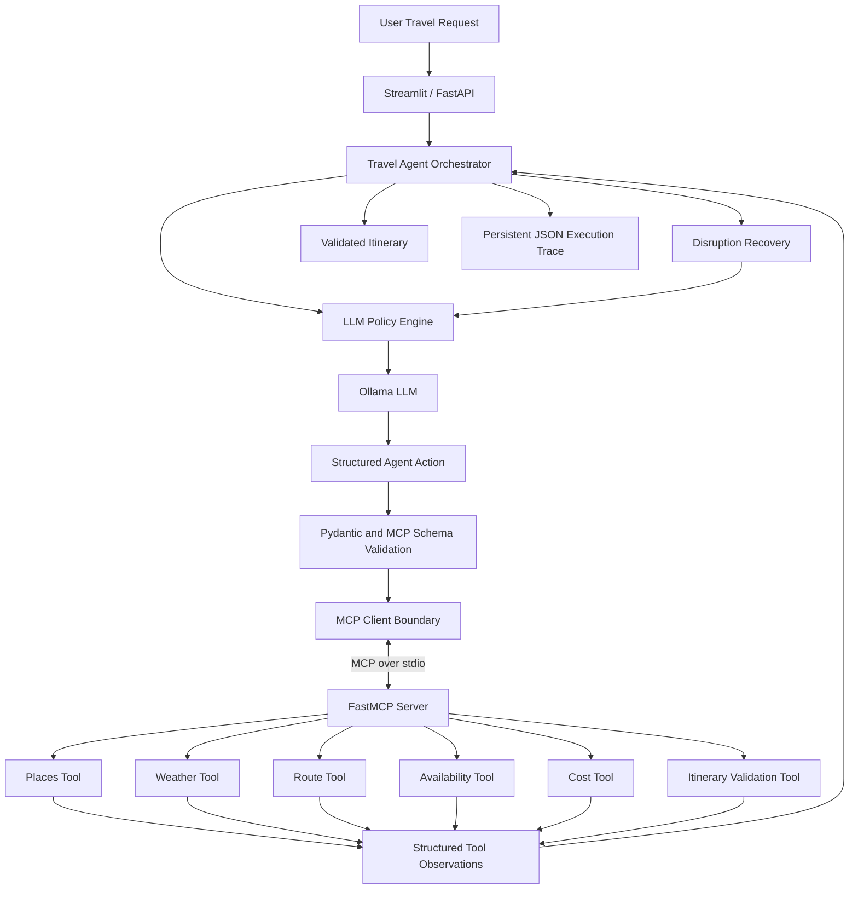

# Resilient Horizon Travel Engine (L2 Agent Edition)

[](https://www.python.org/)
[](https://fastapi.tiangolo.com/)
[](https://streamlit.io/)
[](https://modelcontextprotocol.io/)

**Resilient Horizon Travel Engine** is an L2 agentic travel-planning and disruption-recovery application. It uses an LLM-driven policy engine to select tools dynamically, observe their results, handle travel disruptions, and validate the final itinerary.

The application follows an iterative agent workflow:

**DECIDE → VALIDATE → ACT → OBSERVE → REPEAT**

It combines an Ollama-based LLM policy engine, structured action validation, an official Model Context Protocol (MCP) client-server integration, evidence-based recovery, and persistent execution traces.

---

## 1. Architecture Overview



### Main components

| Component | Responsibility |
|---|---|
| Streamlit UI | Collects travel requirements and displays results |
| FastAPI | Provides REST API endpoints |
| Travel Agent | Orchestrates the iterative agent workflow |
| LLM Policy Engine | Selects the next action based on current observations |
| Action Models | Validates structured agent actions |
| MCP Client Boundary | Discovers and invokes tools through the MCP protocol |
| FastMCP Server | Registers and exposes the six MCP tools |
| Recovery Engine | Handles unsuitable weather and itinerary adjustments |
| Trace Recorder | Saves execution history for inspection |

---

## 2. Key L2 Features

### 2.1 LLM-driven dynamic decision-making

The policy engine uses Ollama to determine the next appropriate action based on:

- User travel requirements
- Previously executed tool calls
- Tool observations and errors
- Current itinerary
- Validation results
- Remaining agent iterations

The application validates the model's structured response before executing an action.

If the LLM is unavailable or produces an invalid response, the deterministic fallback policy provides a controlled alternative.

### 2.2 Structured action validation

The project uses Pydantic action models to validate agent decisions.

An action can represent either:

- `tool`: Invoke a registered tool.
- `finish`: Complete the planning process when the required conditions are satisfied.

The policy engine also validates tool arguments against the input schemas discovered from the MCP server.

This helps prevent malformed arguments and unknown tool calls from reaching execution.

### 2.3 Genuine Model Context Protocol integration

The project uses the official MCP Python SDK.

- `FastMCP` registers tools on the MCP server.
- The MCP client connects using `stdio_client`.
- `ClientSession` initializes the connection and discovers available tools.
- The boundary invokes tools through MCP rather than directly presenting ordinary Python functions as MCP tools.
- Tool results are converted into structured observations for the agent.

### 2.4 Weather-aware itinerary recovery

The application retrieves weather information through the Open-Meteo API.

When weather conditions are unsuitable for outdoor activities, the agent can reconsider the itinerary and select alternative activities.

It also tracks weather coverage across the requested travel days before allowing the workflow to finish.

### 2.5 Evidence-based execution traces

Each execution records relevant information, including:

- Agent decisions
- Selected tool names
- Tool arguments
- Tool observations
- Errors and recovery decisions
- Validation results
- Final itinerary status

Traces are saved as JSON files under the `traces/` directory.

### 2.6 Deterministic demo mode

The project includes a deterministic demo mode for reproducing predefined travel and disruption scenarios, including Goa weather-recovery examples.

This makes it easier to demonstrate the recovery workflow consistently.

---

## 3. Registered MCP Tool Catalogue

The MCP server exposes six tools.

| Tool | Purpose | Important input parameters |
|---|---|---|
| `places.searchAttractions` | Searches attractions for a destination | `destination` (required), `interests`, `indoor_only` |
| `weather.getForecast` | Retrieves weather conditions and outdoor suitability | `destination` (required), `date`, `day` |
| `route.estimateTravel` | Estimates travel distance and duration | `origin` and `destination` (required), `mode` |
| `availability.checkStatus` | Checks attraction availability | `attraction_name` (required), `date`, `time_of_day` |
| `cost.calculateEstimate` | Estimates trip expenses | `activities`, `transit_costs`, `daily_food_allowance_inr` |
| `validation.validateItinerary` | Checks itinerary constraints | `itinerary` and `budget_inr` (required), `interests`, `weather_conditions` |

The MCP server provides the actual input schemas. The agent uses the discovered tool catalogue to validate its proposed arguments before execution.

---

## 4. Data Sources and Provider Boundaries

The application distinguishes between live external data and simulated or locally calculated results.

| Service | Implementation | Data type |
|---|---|---|
| Weather forecast | Open-Meteo API | Live external weather data |
| Attraction search | Simulated place catalogue | Simulated results |
| Route estimation | Estimated transit calculator | Simulated estimates |
| Attraction availability | Simulated availability service | Simulated results |
| Cost estimation | Local calculation logic | Calculated estimates |
| Itinerary validation | Local validation logic | Rule-based validation |

**Important:** Only the weather integration retrieves live external data in the current real-provider implementation. Places, route, and availability results should not be interpreted as verified live information.

### Configured weather destinations

The real weather provider currently contains configured coordinates for:

- Goa
- Kakinada
- Bengaluru
- Hyderabad
- Mumbai
- Delhi
- Jaipur
- Chennai
- Kolkata

Other destinations are not automatically guaranteed to work with the real weather provider. Unsupported destinations should produce a clear error instead of silently using an unrelated default location.

---

## 5. Technology Stack

| Technology | Usage |
|---|---|
| Python | Application implementation |
| Ollama | Local LLM inference |
| Llama 3.2 | Default language model |
| FastMCP | MCP server and tool registration |
| MCP Python SDK | Client-server tool communication |
| Pydantic | Structured data and action validation |
| FastAPI | Backend REST API |
| Streamlit | User interface |
| Open-Meteo | Live weather data |
| Pytest | Automated testing |

---

## 6. Installation and Setup

### Step 1: Clone the repository

```bash
git clone https://github.com/Lavanya5-12/Resilient_Horizon_Travel_Engine.git
cd Resilient_Horizon_Travel_Engine
```

### Step 2: Create a virtual environment

```bash
python -m venv venv
```

Activate it on Windows:

```powershell
.\venv\Scripts\Activate.ps1
```

### Step 3: Install dependencies

```bash
pip install -r requirements.txt
```

### Step 4: Install and start Ollama

Install Ollama, then download the default model:

```bash
ollama pull llama3.2:3b
```

Start Ollama if it is not already running.

The policy engine can use its deterministic fallback when Ollama is unavailable.

### Step 5: Configure environment variables

Example configuration (see `.env.example`):

```bash
LLM_MODEL=llama3.2:3b
OLLAMA_BASE_URL=http://localhost:11434
OLLAMA_REQUEST_TIMEOUT=10
REQUIRE_OLLAMA_FOR_DEMO=false
MAX_ITERATIONS=8
```

In PowerShell:

```powershell
$env:LLM_MODEL = "llama3.2:3b"
$env:OLLAMA_BASE_URL = "http://localhost:11434"
$env:OLLAMA_REQUEST_TIMEOUT = "10"
$env:REQUIRE_OLLAMA_FOR_DEMO = "false"
```

Use the project's `.env.example` as a reference for configuration.

---

## 7. Decision Provenance, Trace Auditing, and Termination Integrity

### 7.1 Auditing Decision Provenance in Execution Traces

Every execution generates an auditable JSON trace under `traces/` (`trace_<session_id>_<dest>.json`). This trace provides cryptographic request hashes, step-by-step decision provenance, and an authoritative decision summary:

```json
{
  "termination_reason": "policy_finish",
  "decision_summary": {
    "ollamaCalled": true,
    "configuredModel": "llama3.2:1b",
    "effectiveTimeoutSeconds": 10.0,
    "requireOllamaForDemo": false,
    "totalIterations": 8,
    "ollamaDecisionsCount": 8,
    "fallbackDecisionsCount": 0,
    "safetyOverridesCount": 1,
    "terminationReason": "policy_finish"
  },
  "iteration_steps": [
    {
      "iteration": 1,
      "decision_provider": "ollama",
      "model": "llama3.2:1b",
      "ollama_request_succeeded": true,
      "fallback_used": false,
      "fallback_reason": null,
      "original_decision": {
        "action": "tool",
        "tool_name": "places.searchAttractions",
        "arguments": {"destination": "Goa", "interests": ["Beaches"]},
        "reasoning": "Need attractions for Goa"
      },
      "policy_decision": { ... },
      "safety_override_applied": false,
      "safety_override_reason": null,
      "is_llm_decision_executed": true,
      "executed_action": "tool",
      "executed_tool": "places.searchAttractions",
      "executed_arguments": { ... },
      "tool_execution_status": "success",
      "observation_summary": "Retrieved 5 candidate attractions."
    }
  ]
}
```

### 7.2 Distinguishing LLM Decisions from Fallbacks, Safety Overrides, and Orchestrator Completion

The trace makes it unambiguous who made each decision:
- **`is_llm_decision_executed: true`**: Genuine LLM selection executed without modification.
- **Deterministic Fallback (`fallback_used: true`, `decision_provider: "deterministic_fallback"`)**: Triggered when Ollama is unavailable, times out, returns invalid JSON, produces an illegal schema, or attempts an unnecessary repeated attraction search. The exact trigger is preserved in `fallback_reason`.
- **Safety Overrides (`safety_override_applied: true`, `is_llm_decision_executed: false`)**: Triggered when the LLM attempts to finish before creating an itinerary or before gathering required multi-day weather forecasts. A safety-overridden action is never misrepresented as an independent LLM decision.
- **Deterministic Orchestrator Completion (`decision_provider: "orchestrator"`, `ollama_request_attempted: false`)**: Triggered when all five planning requirements are satisfied (complete multi-day itinerary, multi-day weather coverage, attraction availability, routing between distinct locations, itemized cost estimation) without pending disruptions or warnings. The orchestrator deterministically finishes the planning loop and proceeds to authoritative final validation without making a redundant LLM call.

### 7.3 Authoritative Loop Termination Reasons

The engine records an authoritative `termination_reason` in the response payload and execution trace:
| Reason | Condition | Resulting Status |
|---|---|---|
| `orchestrator_completion` | Orchestrator deterministically completed the loop when all 5 requirements were satisfied, and authoritative final validation passed | `verified` |
| `policy_finish` | Policy legitimately chose `finish` and the itinerary passed all authoritative validation checks | `verified` |
| `final_validation_failure` | Policy chose `finish` or completed planning, but authoritative final validation failed (e.g. budget, weather, or structure constraint violated) | `unverified` |
| `invalid_action` | Action schema validation failed, unknown tool requested, or strict Ollama requirement failed | `unverified` |
| `iteration_limit` | Loop exhausted `max_iterations` without completing planning | `unverified` |
| `tool_execution_failure` | Fatal unrecoverable MCP tool error | `unverified` |
| `safety_termination` | Safety gate aborted execution due to unrecoverable constraint | `unverified` |
| `exception` | Unhandled runtime exception occurred | `unverified` |

### 7.4 Timeout Configuration and Strict Ollama Demo Mode

Configure via `.env` or environment variables:
- **`OLLAMA_REQUEST_TIMEOUT=10`**: Timeout in seconds for HTTP requests to the Ollama server (safe minimum: 1.0s, default: 10.0s). Prevents agent hangs if Ollama is unresponsive.
- **`REQUIRE_OLLAMA_FOR_DEMO=false`**: When set to `true`, demo runs strictly require valid, schema-compliant Ollama responses. If Ollama fails, times out, or returns an invalid action, the engine rejects the step without fallback and terminates with `status: "unverified"` and `termination_reason: "invalid_action"`.

---

## 8. Running the Application

### Option A: Streamlit interface

```bash
streamlit run app.py
```

Open:

`http://localhost:8501`

### Option B: FastAPI backend

```bash
python -m uvicorn backend.main:app --host 127.0.0.1 --port 8000 --reload
```

API documentation:

`http://localhost:8000/docs`

---

## 9. Running Automated Tests

Run the complete test suite:

```bash
python -m pytest -o pythonpath=. -q
```

Run focused weather, agent, and demo-provider tests:

```bash
python -m pytest tests/test_weather_tool.py tests/test_demo_provider.py tests/test_agent.py -q
```

The automated test suite contains 115 comprehensive tests covering:

- Agent dynamic decision-making and loop termination paths
- Pydantic action and MCP schema argument validation
- Genuine MCP client-server lifecycle, tool discovery, and execution
- Open-Meteo weather retrieval, error handling, and multi-day coverage
- Destination routing between distinct itinerary locations
- Attraction availability checking and candidate discovery
- Weather-aware disruption detection and itinerary recovery
- Authoritative post-loop validation and SHA-256 request integrity checks
- Strict Ollama mode enforcement and fail-closed termination

---

## 10. Example Execution Scenarios

### Scenario 1: Kakinada travel planning

**Example request:**

> Plan a 3-day Kakinada trip under ₹10,000 for food and sightseeing.

Expected workflow:

1. Interpret the user's travel requirements.
2. Search for suitable attractions.
3. Retrieve weather information for the requested travel days.
4. Estimate transport and activity costs.
5. Validate the itinerary against the budget.
6. Produce the final itinerary and save its execution trace.

Weather retrieval requires a supported destination and a valid forecast response.

### Scenario 2: Goa weather disruption recovery

**Example request:**

> Plan a 4-day Goa trip with a budget of ₹15,000.

In deterministic demo mode, the application can reproduce a predefined weather disruption.

Expected workflow:

1. Detect an unsuitable outdoor-weather condition.
2. Identify the affected activity.
3. Select an appropriate alternative.
4. Re-evaluate the itinerary and estimated expenses.
5. Validate the revised itinerary.
6. Record the recovery decisions in the execution trace.

---

## 11. Project Structure

```text
Resilient_Horizon_Travel_Engine/
│
├── app.py
├── requirements.txt
├── .env.example
├── README.md
│
├── backend/
│   ├── main.py
│   │
│   ├── agent/
│   │   ├── travel_agent.py
│   │   ├── llm_policy.py
│   │   ├── action_models.py
│   │   ├── prompts.py
│   │   ├── recovery.py
│   │   └── reflection.py
│   │
│   ├── tools/
│   │   ├── mcp_server.py
│   │   ├── mcp_boundary.py
│   │   ├── weather.py
│   │   ├── places.py
│   │   ├── route.py
│   │   ├── availability.py
│   │   ├── cost.py
│   │   └── validation.py
│   │
│   └── providers/
│       ├── real.py
│       └── demo.py
│
├── tests/
│
├── docs/
│
└── traces/
```

*The structure above summarizes the main application components; individual files may vary as the project evolves.*

---

## 12. Future Improvements

Potential future improvements include:

- Integrating live attraction and route APIs.
- Connecting real attraction availability providers.
- Supporting additional destinations through dynamic geocoding.
- Improving LLM decision quality and tool-selection efficiency.
- Expanding automated end-to-end testing.
- Adding stronger recovery evaluation and observability.

---

## 13. Project Objective

The primary objective of Resilient Horizon Travel Engine is to demonstrate an agentic application that can make structured decisions, select tools dynamically, observe execution results, recover from disruptions, and validate its final output.

The project combines LLM-based reasoning with deterministic safeguards and an actual MCP tool boundary to create a more controlled and explainable travel-planning workflow.

**Repository:** https://github.com/Lavanya5-12/Resilient_Horizon_Travel_Engine